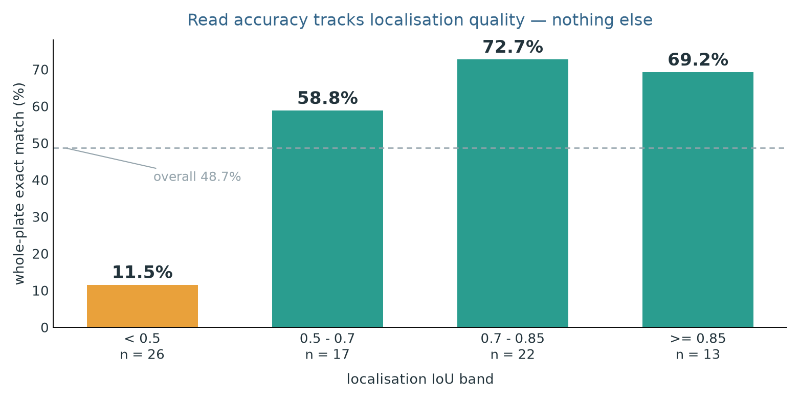
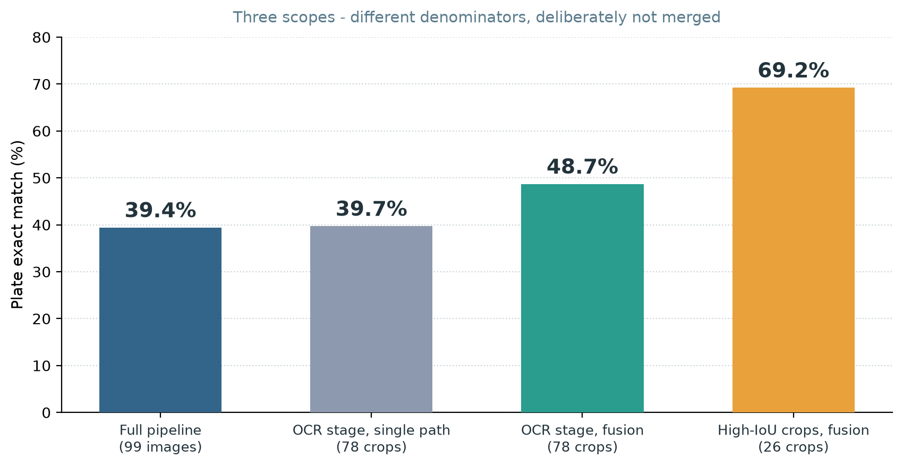
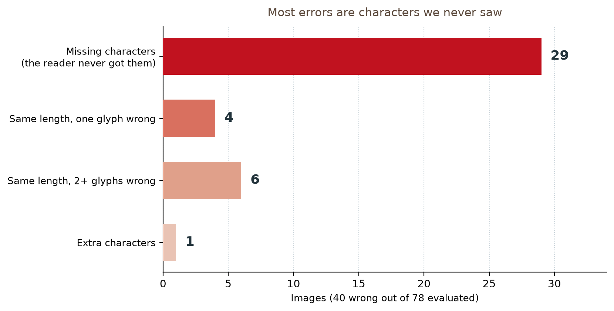

<!-- _class: lead -->
<!-- _footer: '' -->

# Hong Kong Licence Plate Recognition

## CIS342 Course Project - Group 6

### A-line: image to a rectified crop  ·  B-line: OCR and post-processing

---
<!-- _class: lead -->

# A-line: image to a rectified crop

<!--
Sections 1-5. Six slides, and every number on them was re-measured from the
notebook rather than copied from an earlier draft. Denominator is stated on
each slide, because it changes: 100 sampled -> 99 scored -> 78 crops -> 26 fused.
-->

---

## 100 plates, no plate strings in the source

- **Roboflow `hk-fszrn`, 1,491 images, CC BY 4.0** - we sampled 100 with a fixed seed, fingerprint `bd1a4489`
- **The dataset ships boxes, not text** - every plate string in `labels.csv` was typed by hand
- **16 candidates dropped before sampling** - plate box narrower than 40 px, unreadable at any setting
- **Difficulty is recorded and it gates scoring** - 89 normal / 10 hard / 1 unreadable; the unreadable one is excluded from every metric

<!--
The fingerprint matters more than it looks. Re-running the sampler with the same
seed has to produce the same 100 files, otherwise the hand-typed labels point at
the wrong images. It is the one guard that stops a re-run from silently
destroying a day of annotation.
-->

---

## Localisation is a proposal step, not a detector

- **Colour mask, contour, quad** - no learned detector; this is geometry plus a hand-designed score
- **Propose generously** - five candidates per image, ranked afterwards
- **The score measures "looks like a plate"** - left: 0.90 and correct; right: 0.82 on the *neighbouring* car
- **A dense scene breaks it** - two plates in frame and the ranking has no way to tell which one the label meant

<!--
This is the honest version of the failure. The right-hand image is not a
threshold problem: the wrong candidate scores 0.82 and the right one is not in
the top five at all. No cut-off recovers it, because the score was never asked
"which of these two cars is the subject".
-->

---

## Where the locator stands

- **recall@1 = 51.5%, recall@5 = 60.6%** - 99 scored images, IoU >= 0.5 against the hand-drawn box
- **78.8% clear the 0.60 confidence gate** - 21 of 99 stop here and never reach the B-line
- **Mean best IoU 0.50, and the histogram is bimodal** - so the mean describes nothing
- **It either finds the plate or it does not** - 35% of images sit below IoU 0.3 rather than hovering at 0.4

<!--
The bimodality is the most useful diagnostic in this section. A model whose
errors cluster around the decision boundary is a tuning problem. A model that is
either exactly right or completely wrong is a different problem: the candidate
generator never proposed the right region, so the scorer never had a chance.
-->

---

## Extraction answers "which pixels", not "where"

- **`segment(img, quad) -> (plate_bgr, mask)`** - takes the *original* image, not the preprocessed one
- **`quad` is deliberately loose** - the locator over-covers, so the crop still holds bumper and bodywork
- **The mask is the real output** - 255 = plate, 0 = padding; only 57% of this crop is plate
- **Before this change the mask was always 255** - the B-line could not tell padding from plate and trusted every crop equally

<!--
The mask exists because a tight rectangle cannot be produced for a skewed
plate. Once you admit the crop contains non-plate pixels you have to say which
ones, and that is a mask. Both the B-line binariser and our own rectifier read
it; neither trusts the rectangle boundary.
-->

---

## Rectification: fit four edges, not one rotated box

- **`minAreaRect` is a parallelogram by construction** - opposite edges always differ by 0.0 deg, so it cannot bend
- **Perspective is exactly that trapezoid** - 2.2 and 0.2 deg of opposite-edge difference here, up to 10.1 deg on harder plates
- **So fit each edge separately** - `approxPolyDP` seed, one Huber `fitLine` per edge, intersect the four lines
- **Guard against over-correction** - pure `approxPolyDP` moved whole-plate accuracy 23.2% to 23.2%: two fixed, two broken

<!--
The guard is the interesting part. A geometrically truer quadrilateral is not
automatically a better OCR input: fitting the mask's sawtooth boundary rotates a
plate that was already axis-aligned by a fraction of a degree, and that is enough
to shift a character boundary. So the code refuses to warp when the fitted quad
is barely off-parallelogram and falls back to minAreaRect. Across the 99 images
that produced 84 warped crops and 16 fallbacks, and the size contract held 100
out of 100 at exactly 480 x 140.
-->

---

## The ceiling is localisation, not recognition

- **Below IoU 0.5 the reader is nearly blind** - 11.5% whole-plate on 26 images, against 67.3% above it
- **Nothing in the OCR explains that gap** - same reader, same binariser, same format rules; only the crop differs
- **Here is why the two numbers never merge** - 48.7% over 78 crops is what a user gets; 69.2% over the 26 curated ones is what a good crop buys
- **So the next effort belongs upstream** - a learned plate detector replaces the colour mask and the hand-tuned score, keeping the mask handover and the 480 x 140 contract

<!--
This slide is deliberately last, because it reframes the hours spent on
rectification. Rectification is worth 7.7 points on the curated set.
Localisation is worth roughly 51 points on the same set. Effort should follow the
second number, and the presentation should say so rather than defend the first.
-->

---

## From a rectified crop to a plate string

**Contract handed over by the A-line**

| Direction | Payload |
| --- | --- |
| A to B | `upright_bgr`: 480 x 140, BGR uint8 |
| A to B | `upright_mask`: 255 = real pixels, 0 = padded |
| B to A | `text`, `valid`, `conf` |

**Four stages we deliver**

- **§6** binarise, line bands, character split, recognition
- **§7** Hong Kong plate format validation and correction
- **§8** two-path integration and the dark-plate guard
- **§9** evaluation in three scopes

<!--
Never trust a single recogniser: two independent readings, the plate format
decides which one we keep, not the confidence score.
Every number carries its scope - the three denominators are never merged.
-->

---
<!-- _class: lead -->

# B-line: OCR, post-processing and integration

<!--
Sections 6-9. Five slides. The handover contract on the previous slide is what
makes this half testable on its own: it receives a 480 x 140 crop and a mask,
and it never looks at the original photograph. Every number here is reported
against one of three scopes, and the scope is always printed next to it.
-->

---

## We own the split, we borrow the recogniser

Hong Kong plates use a stroke weight, aspect ratio and surface texture that no available font reproduces.
*Our synthetic CNN reaches 100% on its own training data and 0 out of 7 on real plates. The gap is in the glyph, not in the training.*

| §6 - 7 clean plate crops (upper bound of OCR) |  |
| --- | ---: |
| Hershey vector template matching | 0 / 7 |
| Custom CNN, synthetic (Hershey fonts) | 0 / 7 |
| Custom CNN, synthetic (7 Windows fonts) | 0 / 7 |
| EasyOCR whole image, no own segmentation | 5 / 7 |
| **Ours: own split + EasyOCR per line** | **7 / 7** |
| **§9 - rectified pipeline output** | **78 / 26 crops** |
| Single path, own split only | 39.7% / 61.5% |
| **Two-path fusion** | **48.7% / 69.2%** |

---

## Binarise, split, then let a trained reader read

- **One global threshold, not adaptive** - illumination normalisation plus one Otsu; adaptive mangled a clean crop
- **Bands first, characters second** - two-line and cross-border layouts share one splitter
- **Two readers, one decision** - band-by-band wins on clean crops, whole-image wins with bodywork

---

## Hong Kong plate grammar as a prior

| Class | Pattern | Example |
| --- | --- | --- |
| Standard | 2 letters + 102-9998, never I/O/Q | VF 9219 |
| Single letter | 1 letter + number (legacy) | B 281 |
| Personalised | up to 8 characters, at least one letter | BORACAY |
| Cross-border | 粤Z + 4 digits + 港 | 粤Z 6796 港 |

**What the post-processor does**

- Confusions become *candidates*, not certainty: O/0, I/1, S/5, B/8, Z/2, G/6
- Every candidate is scored by plate class; ties are broken by edit distance to the raw reading
- Two guards against over-acceptance: a standard-shaped string outside the number range is rejected, and a cross-border-shaped string is sent to the Chinese re-check
- Cross-border is allowed only on dark plates (median grey below 90 inside the mask) - a white plate must never become 粤Z

---

## Three scopes, reported separately

- **Different denominators, on purpose** - 99 images, 78 crops, 26 high-IoU crops; never merged
- **Fusion pays** - +9.0 points on 78 crops, +7.7 on the 26 crops
- **Geometry pays more** - 57.7% to 69.2% once GEO-01 replaced a plain resize
- **The upper bound** - 7/7 clean crops; the gap to 39.4% is localisation, not OCR

<!--
Q&A guard - do not volunteer this, only answer if asked.

Likely question: why 78 crops and not 99 images?

Answer: the locator gates candidates at 0.60, so 21 of the 99 images never
produce a crop and never reach us. The 78 that do are the honest denominator
for the OCR stage; the 99-image bar keeps those localisation failures in, which
is why the two are reported side by side and never averaged.

An earlier draft used a 95-crop set measured before the colour-mask ladder was
added. The ladder changed candidate scores, 17 of those crops now score 0.457
to 0.597 - below the gate - and none of the 17 reads correctly, so they were
dropped rather than quietly kept in the denominator.

The 26-crop and 7/7 numbers are unaffected - they are a different denominator.
-->

---

## Most errors are characters we never saw

- **29 of 40 wrong plates are missing characters** - the reader never got them, including the plates it returned empty
- **The other 11 are not missing** - 10 keep the same length (4 differ by one glyph: 3-8, C-G, W-H, Z-L; 6 differ by two or more, e.g. 960GKF to TER209) and 1 gains a character (DM6368 to DMA6368)
- **Why** - the crop still holds bumper and bodywork; dark regions merge into the text band
- **A position prior is not the fix** - all five one-glyph predictions already pass the HK format check; they need a tighter crop upstream, not more grammar
