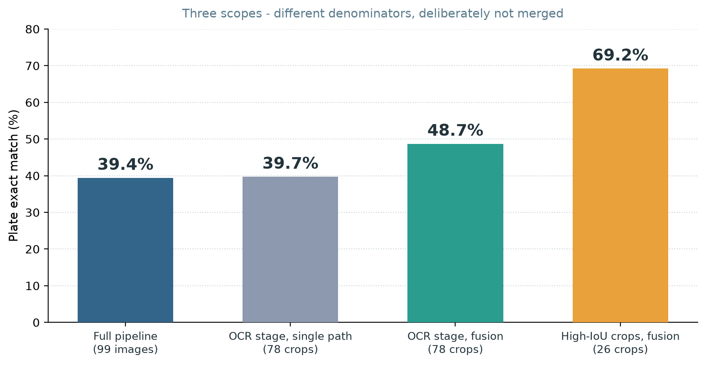
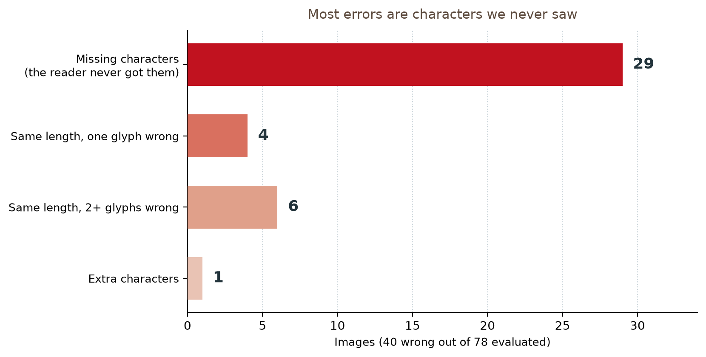

<!-- _class: lead -->
<!-- _footer: '' -->

# 香港車牌辨識

## CIS342 課程專題 - 第 6 組

### A 線：從影像到轉正後的車牌裁切  ·  B 線：OCR 與後處理

<!--
中文對照版，用途是自己讀懂內容，不是上台用的版本。
上台用 main.md（全英文），兩份的頁序、圖片版位、數字完全一致。
-->

---
<!-- _class: lead -->

# A 線：從影像到轉正後的車牌裁切

<!--
對應原文 Sections 1-5，共六頁。
每一頁的數字都是重跑 notebook 量出來的，不是抄舊稿。
分母會變，所以每頁都標清楚：抽樣 100 張 → 評分 99 張 → 產生裁切 78 張 → 高 IoU 26 張。
-->

---

## 100 張車牌，但來源裡沒有任何車牌字串

- **Roboflow `hk-fszrn`，共 1,491 張，授權 CC BY 4.0** —— 用固定亂數種子抽 100 張，指紋 `bd1a4489`
- **資料集只給框，不給字** —— `labels.csv` 裡每一條車牌字串都是人手打上去的
- **抽樣前先淘汰 16 張** —— 車牌框窄於 40 px，任何設定下都讀不出來
- **難度有記錄，而且會影響計分** —— normal 89 / hard 10 / unreadable 1，那 1 張不可讀的從所有指標中排除

<!--
為什麼要強調「指紋」：用同一個種子重跑取樣，必須得到同樣的 100 個檔名，
否則人手打的標註就對到錯的圖上。這是唯一能防止「重跑一次就默默毀掉一天標註」的保險。
-->

---

## 定位只是「提議」，不是偵測器

- **顏色遮罩 → 輪廓 → 四邊形** —— 沒有訓練過任何偵測器，這是幾何加上手工設計的評分
- **寧可多提議** —— 每張圖給五個候選，之後才排序
- **評分衡量的是「看起來像車牌」** —— 左：0.90 且正確；右：0.82 但指到**隔壁那台車**
- **場景一密就失效** —— 畫面裡有兩塊車牌時，排序無從得知標註指的是哪一台

<!--
這是最誠實的失敗版本。右邊那張不是調門檻就能救：錯誤候選得 0.82，而正確候選連前五名都進不去。
不管門檻切在哪裡都救不回來，因為評分函式從來沒被問過「這兩台車哪一台才是主角」。
-->

---

## 定位器目前的表現

- **recall@1 = 51.5%，recall@5 = 60.6%** —— 99 張可評分影像，與人工標註框的 IoU >= 0.5
- **78.8% 通過 0.60 的信心門檻** —— 剩下 21 張（共 99 張）在這裡就結束，永遠到不了 B 線
- **best IoU 平均 0.50，但直方圖是雙峰** —— 所以平均值其實什麼都沒說明
- **要麼找到，要麼完全沒有** —— 35% 的影像落在 IoU 0.3 以下，而不是在 0.4 附近徘徊

<!--
雙峰是這一節最有用的診斷。如果錯誤擠在決策邊界附近，那是「調參」問題；
但如果模型要麼完全正確、要麼完全錯誤，那是另一種問題：
候選產生器根本沒提議到正確區域，評分器再準也沒機會。
-->

---

## 擷取要回答的是「哪些像素」，不是「在哪裡」

- **`segment(img, quad) -> (plate_bgr, mask)`** —— 吃的是**原圖**，不是前處理後的圖
- **`quad` 故意留鬆** —— 定位器會多框一圈，所以裁切圖裡還帶著保險桿與車身
- **真正的輸出是 mask** —— 255 = 車牌，0 = 補邊；這張裁切圖只有 57% 是車牌
- **改動之前 mask 永遠是 255** —— B 線分不出補邊與車牌，只能對每張裁切一視同仁

<!--
為什麼需要 mask：車牌一旦是斜的，就不可能用一個貼緊的長方形框住。
一旦承認裁切圖裡混有非車牌的像素，就必須說清楚「哪些是、哪些不是」——那就是 mask。
B 線的二值化與我們自己的校正器都讀它，兩邊都不相信矩形的邊界。
-->

---

## 幾何校正：擬合四條邊，而不是一個旋轉矩形

- **`minAreaRect` 在數學上必然是平行四邊形** —— 對邊角差永遠是 0.0°，所以它彎不了
- **透視造成的正是梯形** —— 這張圖的對邊角差是 2.2° 與 0.2°，難一點的車牌可到 10.1°
- **所以逐邊擬合** —— 用 `approxPolyDP` 當種子，每條邊各跑一次 Huber `fitLine`，四條線求交點
- **防止校正過頭** —— 純用 `approxPolyDP` 讓整牌正確率從 23.2% 變成 23.2%：修好兩張、弄壞兩張

<!--
最有意思的是那個「防護」。幾何上更正確的四邊形，不自動等於更好的 OCR 輸入：
沿著 mask 的鋸齒邊界擬合，會把一張本來就擺正的車牌轉掉零點幾度，而那樣就足以讓字元邊界位移。
所以程式在「擬合出來的四邊形幾乎還是平行四邊形」時拒絕變形，退回 minAreaRect。
99 張之中有 84 張走透視變形、16 張走回退，尺寸契約 100/100 全部維持 480 x 140。
-->

---

## 天花板在定位，不在辨識

- **IoU 低於 0.5 時，辨識器幾乎全盲** —— 26 張只有 11.5% 整牌正確，而 IoU 0.5 以上的 52 張有 67.3%
- **OCR 那一側沒有任何東西能解釋這個落差** —— 同一個辨識器、同一個二值化、同一套格式規則，只有裁切品質不同
- **兩個數字永遠不會合併** —— 78 張裁切得 48.7%（使用者實際拿到）；26 張精選得 69.2%（上限）
- **所以下一步在上游** —— 換學習式偵測器，保留 mask 交接與 480x140 契約

<!--
這一頁刻意放在最後，因為它重新定義了前面花在幾何校正上的時間該怎麼看：
在校正上多做的努力值 7.7 個百分點，定位值大約 51 個百分點。
力氣應該跟著第二個數字走，簡報應該直接承認這件事，而不是為第一個數字辯護。
-->

---

## 從轉正後的裁切，到一條車牌字串

**A 線交出的契約**

| 方向 | 內容 |
| --- | --- |
| A 交給 B | `upright_bgr`：480 x 140，BGR uint8 |
| A 交給 B | `upright_mask`：255 = 真實像素，0 = 補邊 |
| B 交回 A | `text`、`valid`、`conf` |

**B 線負責的四個階段**

- **§6** 二值化、行帶切分、字元切分、辨識
- **§7** 香港車牌格式驗證與修正
- **§8** 雙路徑整合與深色車牌防護
- **§9** 三種範圍的分開評估

<!--
這一頁是交接點，也是全份簡報的樞鈕：
左邊（A）只保證「交出一張擺正、尺寸固定、且知道哪裡是補邊的圖」，
右邊（B）只保證「從這張圖讀出字串，並用香港車牌語法檢查」。
兩邊唯一的耦合就是這個表格。
-->

---
<!-- _class: lead -->

# B 線：OCR 與後處理

<!--
對應原文 Sections 6-9，共五頁。
上一頁的交接契約，正是讓 B 線可以獨立測試的原因：
它只收到 480 x 140 的裁切與 mask，從不看原始照片。
以下每個數字都會標明它屬於哪一種範圍（99 張 / 78 張 / 26 張），三種分母絕不混用。
-->

---

## 切分是我們做的，辨識器是借來的

香港車牌的字重、長寬比與表面材質，沒有任何現成字型複製得出來。
*我們自製的合成 CNN 在自己的訓練資料上達到 100%，在真實車牌上是 7 張中 0 張。落差在字形，不在訓練。*

| §6 - 7 張乾淨車牌裁切（OCR 的上限） |  |
| --- | ---: |
| Hershey 向量模板比對 | 0 / 7 |
| 自製 CNN，合成資料（Hershey 字型） | 0 / 7 |
| 自製 CNN，合成資料（7 種 Windows 字型） | 0 / 7 |
| EasyOCR 整張圖，不做自己的切分 | 5 / 7 |
| **我們的做法：自己切分 + 逐行 EasyOCR** | **7 / 7** |
| **§9 - 校正後的管線輸出** | **78 張 / 26 張** |
| 單路徑，只用自家切分 | 39.7% / 61.5% |
| **雙路徑融合** | **48.7% / 69.2%** |

<!--
這張表的用途是把「功勞」分清楚：
前四列證明「換字型、換模型」都救不了，問題出在真實車牌的字形不在任何字型裡；
第五列證明「只要切分正確，現成的 EasyOCR 就夠好」。
所以我們把力氣放在切分與後處理，而不是自己訓一個辨識器。
-->

---

## 先二值化、再切分，最後交給訓練過的辨識器

- **用單一全域門檻，不用自適應** —— 先做光照正規化再一次 Otsu；自適應反而把乾淨的裁切弄壞
- **先切行帶，再切字元** —— 雙行式與跨界式版面共用同一個切分器
- **兩個辨識器、一個決定** —— 逐行在乾淨裁切上較好，整張圖在有車身干擾時較好

> 這張圖是隊友產生的英文原圖（`assets/b-ocr-pipeline.png`），所以圖內標註仍是英文。

---

## 把香港車牌語法當作先驗知識

| 類別 | 規則 | 例子 |
| --- | --- | --- |
| 標準 | 2 個字母 + 102-9998，不含 I/O/Q | VF 9219 |
| 單字母 | 1 個字母 + 數字（舊式） | B 281 |
| 自訂 | 最多 8 個字元，至少含一個字母 | BORACAY |
| 跨界 | 粤Z + 4 位數字 + 港 | 粤Z 6796 港 |

**後處理器實際做的事**

- 易混淆字元變成**候選**，而不是直接認定：O/0、I/1、S/5、B/8、Z/2、G/6
- 每個候選都用它所屬的車牌類別評分；同分時以「與原始讀值的編輯距離」決勝
- 兩道防止過度接受的關卡：標準形狀但號碼超出範圍 → 拒絕；跨界形狀 → 送去中文複核
- 跨界格式只允許出現在深色車牌（mask 內中位灰階低於 90）—— 白牌永遠不該被讀成 粤Z

---

## 三種範圍，分開報告

- **分母不同是刻意的** —— 99 張影像、78 張裁切、26 張高 IoU 裁切，絕不合併
- **融合有回報** —— 78 張 +9.0 個百分點，26 張 +7.7 個百分點
- **幾何校正回報更大** —— GEO-01 換掉純 resize，57.7% → 69.2%
- **上限在哪** —— 乾淨裁切 7/7；與 39.4% 的落差屬於定位，不屬於 OCR

<!--
Q&A 應答（不要主動講，被問才答）。

可能的問題：為什麼是 78 張，而不是 99 張？

答案：定位在 0.60 信心門檻就把候選擋掉，99 張裡有 21 張永遠產不出裁切，也到不了 B 線。
真正進到 OCR 的是 78 張，那是 OCR 階段誠實的分母；99 張那根柱把定位失敗留在裡面，
所以兩個並排報告、絕不合併。

早期版本用過一個 95 張的集合，那是顏色遮罩改成雙門檻之前量出來的。雙門檻改變了候選分數，
其中 17 張的 top-1 落到 0.457 ~ 0.597，低於門檻，而且一張都沒讀對 —— 所以是剔除，不是悄悄留在分母裡。

26 張與 7/7 那兩個數字不受影響 —— 它們是另一個分母。
-->

> 隊友產生的英文原圖（`assets/b-results-scope.png`）。


---

## 大部分的錯誤，是我們從未讓它看見的字元

- **40 張錯的裡面有 29 張是缺字** —— 辨識器根本沒拿到那些字元，其中 2 張是完全讀不到的空字串
- **其餘 11 張不是缺字** —— 10 張長度不變（4 張只差 1 個字元：3-8、C-G、W-H、Z-L；6 張差 2 個以上，如 960GKF→TER209），1 張多了一個字元（DM6368→DMA6368）
- **原因** —— 裁切裡仍帶著保險桿與車身，暗部與文字帶黏在一起
- **位置先驗不是解法** —— 那 4 張只差 1 個字元的預測全部都已經通過香港車牌格式檢查；它們要的是更貼緊的裁切（上游），不是更多文法規則

<!--
四類互斥，相加剛好 40（78 張基準）：29 缺字（含 2 張空字串）+ 4 差 1 字元 + 6 差 2 以上 + 1 多字。
舊版是 95 張基準的 57 張錯，四類為 45 / 5 / 6 / 1 —— 被剔除的 17 張全部落在「缺字」那一類（其中 3 張是空字串）。
-->

